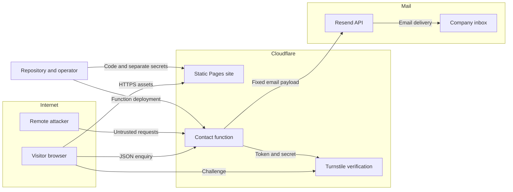

## Executive summary

Applicodo is a public static marketing site with a narrowly scoped contact function. The main risks are inbox/quota abuse by senders who obtain fresh Turnstile tokens, disclosure of enquiry data or service credentials, and malicious changes to the deployed site. The contact code constrains body size, input shape, production origin, CAPTCHA verification, outbound destinations and email recipients; the browser code keeps responses inert and preserves unsent input. Those source controls reduce injection, open-relay and direct-preview abuse; they do not prove Cloudflare/Resend configuration or mailbox delivery. External configuration and live verification remain release checks at the time of this report.

## Scope and assumptions

- **Reviewed runtime:** `functions/api/contact.js`, `functions/api/contact-config.js`, `public/index.html`, `public/assets/contact.js`, `public/_headers`, `public/_routes.json`, and `wrangler.jsonc`.
- **Reviewed delivery tooling:** `package.json`, `package-lock.json`, and the output/deployment boundary. Tests are evidence of application behavior, not production provider availability.
- **Validated with the user on 2026-10-25:** public English marketing page for independent iOS development; name, email and ordinary project message only; fixed recipient `contact@applicodo.com`; Resend sending subdomain `forms.applicodo.com`; no accounts, uploads, payments, lead database, automatic replies or analytics. Keep the existing Cloudflare Pages project and Google Workspace routing; no paid upgrade.
- **Out of scope:** CaptionFast's application/backend, other company projects, Google Workspace internals and Cloudflare/Resend internals. Legacy Jekyll/PHP assets have been removed from the working tree; they are not part of this implementation or deployment. The output root is explicitly `./public` (`wrangler.jsonc:pages_build_output_dir`; removal of the legacy source paths in the current Git change).
- Enquiries are ordinary business contact data, not secrets or regulated special-category data. Messages are delivered to an inbox; absence of a website database does not imply absence of mailbox/provider retention (`PRODUCT.md:Capabilities and Constraints`; `functions/api/contact.js:Resend text payload`).
- The user requested a short public form note only and removed the detailed processor disclosure/expandable privacy section. Internal documentation still records that Cloudflare serves/verifies the form, Resend processes message delivery, and the company inbox retains received enquiries. Actual provider retention follows those services' policies; this report makes no promise that messages are never stored (`public/index.html:#form-privacy`; `README.md:Security and data`; `PRODUCT.md:Capabilities and Constraints`).

**Verified setup:** the existing Pages project now has `production_branch: master`. The managed Turnstile widget “Applicodo contact” permits only `applicodo.com`; its two production secret binding names are present and the preview secret list is empty (`docs/verification/provider-setup.json`). All three Resend sender records resolve on both authoritative nameservers; the pre-existing Workspace records are unchanged, with only the sender additions increasing the record count from 27 to 30 (`docs/verification/sender-dns.json`). The release agent also confirmed all three through public resolvers and observed `forms.applicodo.com` as Verified in Resend. These setup observations do not prove working mail delivery.

**Remaining release facts that change residual risk:** create/configure the dedicated domain-restricted Resend sending key; verify the contact POST rate-limit rule on the proxied apex; verify the actual production/preview environment, live response headers and public-output boundary after deployment; and receive a controlled enquiry in the fixed mailbox. Production sending and inbox delivery remain unverified.

## System model

### Primary components

1. **Browser and static site:** public marketing content, original CaptionFast assets and a three-field contact form. JavaScript lazily fetches widget configuration, explicitly renders Turnstile and submits JSON without persisting input. Only `public/` is configured as the static output, and only `/api/*` invokes functions (`public/index.html:#contact-form`; `public/assets/contact.js`; `wrangler.jsonc:pages_build_output_dir`; `public/_routes.json`).
2. **Pages Functions:** `POST /api/contact` accepts a strict JSON object and controls verification/delivery; `GET /api/contact-config` exposes only a public widget key and safe availability flags (`functions/api/contact.js:handleContact`; `functions/api/contact-config.js:onRequest`).
3. **Cloudflare Turnstile:** official browser widget plus the fixed HTTPS Siteverify endpoint. The server requires literal `success: true`, hostname `applicodo.com` and action `contact` before email delivery (`functions/api/contact.js:SITEVERIFY_URL` and verification checks).
4. **Resend and company inbox:** the function posts a plain-text email to a fixed HTTPS API with a server-held API key, fixed sender/recipient/subject and validated Reply-To. A nonempty provider message ID is required for success (`functions/api/contact.js:RESEND_URL` and delivery payload).
5. **Operator/deployment environment:** Node/locked Wrangler 4.152.0 tooling uploads the public assets and function code; production and preview have explicit distinct delivery flags. Development-only Undici is overridden to 7.30.1 after the initial audit found advisories in 7.30.0 (`package.json:devDependencies`, `overrides`, `scripts`; `package-lock.json`; `wrangler.jsonc:env`). There is no application database or user session in this design. A clean dependency advisory scan does not prove runtime or deployment security.

### Data flows and trust boundaries

- **Internet → Cloudflare Pages:** HTTPS static content and API requests. Browser inputs are attacker-controlled; the edge rate rule is a required external control, not implemented by the function. Only the exact HTTPS apex is accepted for contact delivery (`functions/api/contact.js:PRODUCTION_ORIGIN`).
- **Browser → Turnstile:** a lazily loaded official script renders the widget with action `contact`, receives challenge/browser data and returns a token. The public site key is not a credential; a client-side success signal is not trusted by the contact server (`public/assets/contact.js:loadTurnstile`, `prepareVerification`; `functions/api/contact-config.js:siteKey`; `functions/api/contact.js:verification`).
- **Browser → contact function:** name, email, message and token cross an HTTPS JSON boundary. Exact Origin, production flags, content type, strict four-field shape, control characters and field limits are checked; the stream is capped at 32 KiB even if Content-Length lies (`functions/api/contact.js:handleContact`, `readBoundedJson`, `validatedFields`). Origin is a browser abuse control, not authentication against a custom HTTP client.
- **Contact function → Siteverify:** token and server secret cross fixed HTTPS. Redirects are rejected; a five-second deadline covers connection and body; the response is capped at 16 KiB. Verification errors fail closed (`functions/api/contact.js:upstreamJson`).
- **Contact function → Resend → company inbox:** business contact data and an API credential cross HTTPS to Resend; only message data continues to the fixed mailbox. Provider responses are bounded and not relayed to visitors; delivery acceptance is not proof of inbox receipt (`functions/api/contact.js:delivery`).
- **Repository/operator → deployment:** developer-controlled HTML, JavaScript, assets and functions cross the publication boundary; operator-controlled secrets are separate runtime bindings. Only production flags plus the apex can permit email; previews remain disabled (`wrangler.jsonc:vars` and `env`; both API entrypoints). Deployment credentials and repository permissions remain sensitive operator assets.

#### Diagram

## Assets and security objectives

| Asset | Why it matters | Security objective (C/I/A) |
|---|---|---|
| Enquiry name, email and message | Contains personal contact and commercially relevant project information | C, I |
| Company inbox and Resend quota | Flooding can hide real leads or stop delivery | A, I |
| Turnstile and Resend secrets | Theft can bypass site controls or impersonate the configured sender | C, I |
| Website, domain and deployment integrity | A changed page can misrepresent Applicodo or intercept future enquiries | I, C |
| Public deployment artifacts | Must exclude secrets, private diagnostics, tests and design records | C, I |
| Review and operational signals | Must reveal failures without copying enquiry bodies or addresses into logs | I, C |

## Attacker model

### Capabilities

A remote attacker can fetch public assets and widget configuration, send arbitrary HTTP requests and forged Origin/Content-Length headers, submit hostile strings and fresh challenges, replay used tokens, rotate IPs, and inspect errors. An attacker may pay humans or automation to obtain valid Turnstile tokens. Untrusted enquiry text can also attempt social engineering of the human recipient (`functions/api/contact.js:input and delivery boundaries`).

### Non-capabilities

The baseline remote attacker cannot edit repository files, runtime environment bindings, DNS, Cloudflare rules or Resend settings; cannot choose the server's outbound URL/recipient; and cannot forge successful Siteverify responses over authenticated HTTPS. There is no application account, cross-tenant object, file parser, SQL query, shell execution or visitor-controlled URL fetch in the reviewed function. Operator/provider compromise is modeled separately and is not inferred from public access (`functions/api/contact.js:fixed constants`, `validatedFields`; `wrangler.jsonc`).

## Entry points and attack surfaces

| Surface | How reached | Trust boundary | Notes | Evidence (repo path / symbol) |
|---|---|---|---|---|
| Public HTML, CSS, JavaScript and images | GET on site routes | Deployment → visitor browser | Repository changes or compromised third-party script can affect future visitors; CSP limits executable origins | `public/index.html`; `public/_headers`; `wrangler.jsonc:pages_build_output_dir` |
| Contact JSON | POST `/api/contact` | Internet → Pages Function | Four string fields; 32 KiB streamed limit; fixed production origin and environment guards | `functions/api/contact.js:handleContact`, `validatedFields` |
| Public configuration | GET `/api/contact-config` | Function environment → browser | Returns widget key only when configured production; never returns secrets | `functions/api/contact-config.js:onRequest` |
| Siteverify response | Function fetch to fixed Cloudflare URL | Turnstile → function | Literal success, hostname and action required; bounded response and deadline | `functions/api/contact.js:upstreamJson`, verification checks |
| Email submission/response | Fixed Resend API call | Function → mail provider | Plain text; fixed sender/recipient/subject; visitor controls Reply-To only after validation | `functions/api/contact.js:delivery` |
| Production/preview publication | Wrangler commands | Developer/operator → public runtime | Output root and environment flags are security-critical; secrets must stay in provider bindings | `package.json:scripts`, `wrangler.jsonc:env`, `.gitignore` |
| Error and diagnostic sinks | Responses and provider/platform observability | Runtime → visitor/operator | Responses use generic fixed text; application code does not log payloads | `functions/api/contact.js:jsonResponse`; both API entrypoints |

## Top abuse paths

1. **Exhaust the inbox/quota:** obtain fresh valid contact tokens → send repeated apex POSTs, possibly across IPs → consume mail quota and bury legitimate enquiries. Turnstile alone is not a volume limit (TM-001).
2. **Build an email relay or inject headers:** submit extra recipient fields or CR/LF in the address → try to override recipients/headers → attempt unsolicited third-party delivery. Strict shape, fixed headers and address validation currently block this path (TM-002).
3. **Execute enquiry text:** place HTML/script in name/message → seek reflection in a browser or HTML email → steal visitor/operator data. The current server emits no submitted text and sends only a plain-text body; the frontend must preserve this property (TM-003).
4. **Expose enquiry data or keys:** add verbose diagnostics or publish the repository root → put personal data, credentials or private design records in logs/public files → disclose business contacts or sending authority (TM-004).
5. **Compromise the publication chain:** obtain a repository/deploy credential or execute a malicious tooling dependency → publish credential-harvesting UI or alter the recipient/code → intercept future enquiries and misuse company identity (TM-005).
6. **Bypass production-only abuse controls:** call the direct Pages hostname or deploy preview with live secrets → attempt sends outside the apex WAF → consume inbox/quota. Host checks and explicit flags currently reject direct-host delivery even when secrets exist (TM-006).
7. **Cause unavailable or misleading delivery:** disrupt verification/provider responses or accept mail that later bounces → real enquiries fail or are mistaken for received messages. Timeouts and acceptance checks avoid false server success on immediate provider errors; inbox receipt still needs independent verification (TM-007).

## Threat model table

| Threat ID | Threat source | Prerequisites | Threat action | Impact | Impacted assets | Existing controls (evidence) | Gaps | Recommended mitigations | Detection ideas | Likelihood | Impact severity | Priority |
|---|---|---|---|---|---|---|---|---|---|---|---|---|
| TM-001 | Remote spammer | Fresh successful contact tokens; multiple IPs can increase throughput | Repeated valid submissions consume quota and inbox attention | Lost or delayed business enquiries | Inbox, quota, function availability | Server Siteverify, action/hostname checks, body limits, fixed inbox (`functions/api/contact.js`) | No code-level rate limiter; WAF template exists but enforcement is unverified (`docs/contact-rate-limit.json`) | Verify the scoped rule at five contact POSTs per IP per ten seconds; monitor provider quota; keep delivery switch available. Do not treat Origin as bot authentication | Aggregate status/request counts and Resend quota without message/PII logging | Medium: attackers can solve challenges, though this raises cost | Medium: affects one low-volume marketing channel | medium |
| TM-002 | Remote sender | Direct API access, including forged Origin | Inject header controls or extra delivery fields | Relay, impersonation or misdirected email | Sending identity, recipient integrity | Exact field allowlist, control-character rejection, fixed To/From/subject, validated Reply-To, fixed API URL (`validatedFields`, delivery payload) | Human recipient can still receive deceptive plain-text content | Preserve current envelope invariants; never add visitor-controlled To/CC/BCC or dynamic request URLs; treat message content as untrusted correspondence | Monitor send-volume/anomalous provider failures; test injection regressions | Low: current parser and payload remove the required control | Medium: a future regression could misuse sender reputation | low |
| TM-003 | Remote submitter or compromised widget | Hostile message content, or control of an allowed third-party browser script | Reflect/execute submitted text or read form contents | Data theft and website compromise | Enquiry data, visitor trust | No input echo; plain-text mail; fixed error text; textContent statuses; CSP self/Turnstile without unsafe-inline/eval (`jsonResponse`, delivery payload; `public/assets/contact.js:announce`; `public/_headers`) | Live CSP behavior still requires verification; the official widget remains an external script trust dependency | Preserve inert DOM updates and restrictive CSP; lazy-load the official widget as implemented; retain no-reflection tests and check actual rendered headers | Browser CSP/console review and DOM-focused hostile-text tests | Low: current code is inert; script-provider compromise is a stronger prerequisite | High: malicious browser script could capture future enquiries | medium |
| TM-004 | Developer/operator error or compromised observability | Public output includes sensitive files or diagnostics copy enquiry contents | Expose runtime keys or personal enquiry data | Confidentiality loss and possible sending abuse | PII, secrets, public artifacts | Public output root, ignored local env files, safe server errors and no payload logging (`wrangler.jsonc`, `.gitignore`, API code) | Production log configuration/provider retention/output allowlist still require verification | Deploy only public assets and compiled functions; scan output for secrets/diagnostics; keep env values in production bindings; restrict operational access and document mailbox/provider retention | Public-path probes for env/docs/tests, secret scanning, review of log field names without payload capture | Low: requires operator mistake or privileged access | High for a sending key; medium for limited ordinary enquiry exposure | medium |
| TM-005 | Credential thief or tooling supply chain actor | Access to repository/deploy account, or execution of compromised build tooling | Replace page/function or steal deployment/sending authority | Lead interception, company impersonation, unauthorized publication | Site/domain integrity, secrets, future enquiries | No production npm dependencies, locked Wrangler 4.152.0 and patched Undici 7.30.1 override, explicit public output/scripts (`package.json`, `package-lock.json`, `wrangler.jsonc`) | Provider/repository MFA, token scope and branch/review protections are outside source and unverified; advisory scans cannot rule out unknown malicious tooling | Use MFA and minimum deployment/sending permissions; review production changes; keep provider keys separate from build output; use lockfile installs; revoke unused credentials after verified replacement | Provider audit events, unexpected deploy/recipient changes and Git diff review | Low: needs privileged compromise rather than an ordinary form request | High: can alter all future visitor interactions and mail authority | medium |
| TM-006 | Remote sender or misconfigured preview | A preview/direct URL is reachable; operator could accidentally copy live bindings | Send outside apex zone rules or through preview | Rate-control bypass and unsolicited email | Inbox, quota, production secrets | Exact HTTPS apex check plus two explicit production flags; config does not activate previews; project branch is aligned and preview secret list is empty (`handleContact`, `contact-config.js`, `wrangler.jsonc:env`; `docs/verification/provider-setup.json`) | Actual deployed production/preview behavior still needs proof | Keep preview secrets absent and delivery disabled; probe direct Pages hosts and preview routes before release; do not weaken host checks to facilitate testing | Controlled denied preview/direct-host probes and provider send-count comparison | Low: independent host and environment gates must both be defeated | Medium: bypass would weaken volume controls | low |
| TM-007 | Upstream failure, malicious network conditions or configuration error | Provider outage, invalid sender/key, quota exhaustion, environment mismatch or downstream bounce | Stall/reject delivery or produce misleading success | Lost lead and poor availability | Contact availability, enquiry integrity | Five-second bounded upstream fetch/body, fail-closed verification, no success without provider ID; browser input retention on failure and challenge reset; branch/widget setup and sender DNS are verified (`upstreamJson`, delivery checks; `public/assets/contact.js:submit`; `docs/verification/provider-setup.json`; `docs/verification/sender-dns.json`) | Provider acceptance is not inbox receipt; no durable queue or automatic retries by design; restricted Resend key and live delivery remain pending | Configure the restricted sending key; verify deployed environment and one received controlled enquiry; keep retries explicit; monitor aggregate errors/bounces and quota | Provider activity/bounce status, controlled mailbox receipt, environment confirmation, aggregate 503 rate | Medium: outages/configuration mistakes are plausible | Medium: only this contact channel is affected | medium |

## Criticality calibration

The priority labels concern this small marketing/contact surface, not hypothetical unrelated application accounts.

- **Critical:** systemic administrative compromise extending beyond this page, such as Cloudflare account takeover affecting other production properties, or domain/Workspace administrative takeover enabling broad mail interception. Neither is evidenced by the reviewed contact code.
- **High:** theft of usable deployment authority to replace the site; theft of a broadly usable sending credential to impersonate the company; silent interception of all future enquiries. Remote exploitation of such an outcome would warrant immediate release blocking.
- **Medium:** sustained solved-CAPTCHA flooding that exhausts quota; limited exposure of ordinary enquiry data; an outage or misconfiguration that prevents legitimate contact for a meaningful period.
- **Low:** noisy probing rejected before provider calls; non-sensitive implementation/header disclosure; a header/relay attempt that requires a new regression and is blocked by existing parsing. Public Turnstile site-key disclosure is expected behavior, not a vulnerability.

## Focus paths for security review

| Path | Why it matters | Related Threat IDs |
|---|---|---|
| `functions/api/contact.js` | Owns untrusted input, production guards, verification, fixed mail envelope and provider error handling | TM-001–TM-004, TM-006, TM-007 |
| `functions/api/contact-config.js` | Must expose only public configuration and keep preview/incomplete setup disabled | TM-004, TM-006 |
| `public/index.html` | Defines form collection, the brief inline privacy note and external script/asset references | TM-003, TM-004 |
| `public/assets/contact.js` | Must keep responses inert, retain text on failure and reset consumed challenges | TM-003, TM-007 |
| `public/_headers` and `public/_routes.json` | Govern static CSP/security headers and the function/static publication boundary | TM-003, TM-004, TM-006 |
| `wrangler.jsonc` | Separates production and preview behavior and chooses the output root | TM-004–TM-006 |
| `docs/contact-rate-limit.json` | Defines the exact host/path/method and threshold that must be enforced externally | TM-001, TM-006 |
| `docs/verification/provider-setup.json` and `docs/verification/sender-dns.json` | Record current branch/widget/binding separation and authenticated sender DNS without claiming live message delivery | TM-004, TM-006, TM-007 |
| `package.json` and `package-lock.json` | Define publish commands, `master` release branch, locked Wrangler and the patched Undici override | TM-004, TM-005, TM-007 |
| `tests/contact.test.mjs` and `tests/contact-config.test.mjs` | Exercise abuse rejection and ensure no provider calls occur before guards pass | TM-001–TM-004, TM-006, TM-007 |

## Notes on use

This is a source-grounded design/review artifact, not a penetration-test certificate. The user assumption check-in occurred before implementation; the confirmed answers are reflected above. On 2026-10-25, the current dependency-free backend suite passed **21/21** tests. Those mocks validate decision paths and payload construction; they do not prove external WAF enforcement, Turnstile token service behavior, Resend domain setup or actual mailbox receipt.

**Dependency evidence:** after the Undici override, an independently repeated `npm audit --json` returned zero known vulnerabilities across the installed dependency graph. `npm ls wrangler undici --json` confirmed Wrangler 4.152.0 with overridden Undici 7.30.1. These are advisory/tooling checks, not a claim of zero security risk.

**Frontend source review:** completed for `public/index.html`, `public/assets/contact.js`, `public/_headers` and `public/_routes.json`. The form has no browser storage/logging, status updates use textContent, only confirmed API success resets inputs, challenge tokens reset after attempts, preview/incomplete configuration blocks sending, and static script/frame allowances are restricted to the official Turnstile origin. The current public note is exactly “No analytics. No advertising cookies.” The detailed public processor/footer section has been removed at the user's instruction; internal data-flow and retention boundaries remain documented here and in `README.md`.

**Rendered/client evidence:** `docs/browser-verification.json` records local Chromium checks at seven widths from 320 to 1536 pixels, with loaded images, no horizontal overflow, labelled/required bounded form fields, valid anchors, visible keyboard focus and passing measured AA contrast for the listed text/control pairings. Eleven synthetic DOM/client scenarios passed, including preview/token rejection, provider/HTTP/network errors, duplicate-submit prevention and success-only field reset; no provider request or real email was sent. Reduced-motion rules were checked through CSSOM, not OS preference emulation. Actual Safari/iOS rendering, live headers/WAF enforcement and mailbox delivery are outside that local evidence.

Quality check:

- [x] Both API entrypoints, provider responses, publication and diagnostic surfaces covered.
- [x] Browser, edge/function, verification, mail and operator boundaries represented in threats.
- [x] Runtime separated from deployment tools and tests; removed legacy source is not modeled as a live backend.
- [x] User-confirmed service context and ordinary data sensitivity reflected.
- [x] Source controls distinguished from unverified external controls and residual risks.
- [x] Final frontend source and privacy boundary reviewed.
- [x] Local rendered/client evidence reviewed with Chromium, mock-provider and reduced-motion limits recorded.
- [x] Current project/widget/binding and sender-DNS receipts reviewed.
- [ ] Restricted Resend key, deployed WAF/header behavior and real inbox receipt verified.
